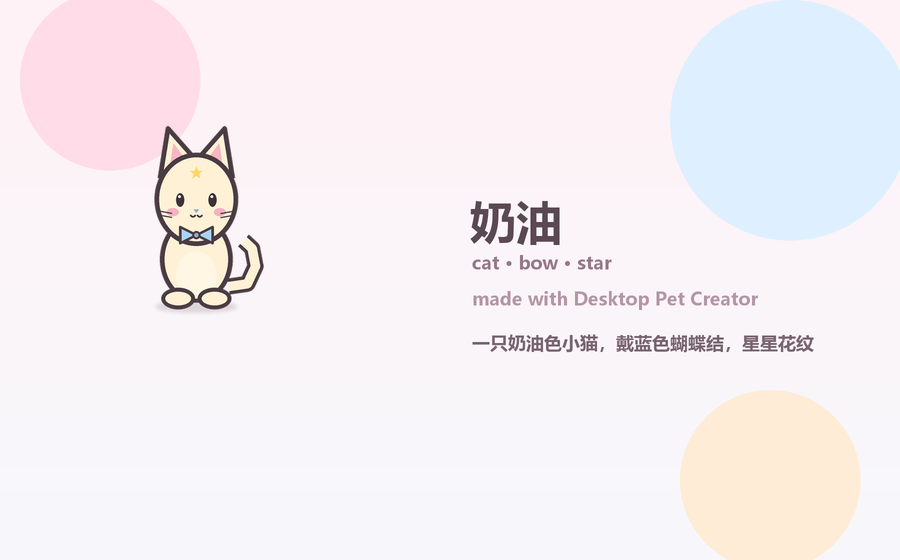
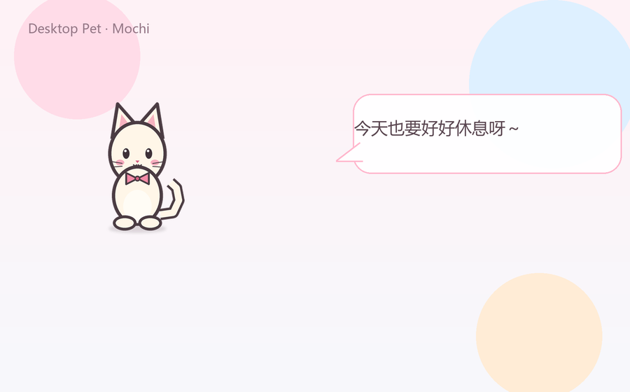

# Desktop Pet Template · 桌宠生成模板

把你的角色变成桌面宠物：**给一张图，或写一句话**，自动生成 idle / walk / jump / ultra 动画，并套用现有的透明桌宠、粉白气泡和圆形轮盘。





> 完整的项目介绍、技术方案和可直接使用的 GitHub 文案见
> [`项目说明.md`](项目说明.md)。
>
> 面向使用者的中文 + English 步骤说明见
> [`使用说明.md`](使用说明.md)。


[](LICENSE)
[](assets/LICENSE)

> [!IMPORTANT]
> **素材版权**
>
> 仓库只自带原创占位角色 **Mochi**（CC0-1.0）。早期本地版本使用的
> `daiji / dazhao / khqn / tiaoyue` 动画和 `ChillHuoFangSong` 字体来自第三方，
> **不能随项目分发，也不能商用**，因此没有进入仓库。
>
> 你用自己的图片或文字生成的角色，版权/授权由你负责；生成包里的
> `SOURCE.txt` 和 `LICENSE.txt` 会提醒这一点。详见
> [`docs/ASSETS.md`](docs/ASSETS.md)。

---

## 这个模板能做什么

```text
一张角色图 / 一句描述 / 一套旧动画
        ↓
角色生成器：去背景、统一尺寸、生成动作、写角色包
        ↓
现有桌宠运行时：透明窗口、气泡、轮盘、聊天、23 个桌面工具
```

- **三种输入**：文字描述、单张图片、已有动画帧文件夹。
- **七种物种**：猫、狗、兔、狐、熊、鸟、史莱姆。
- **配饰与花纹**：围巾、蝴蝶结、眼镜、帽子、耳机、小花；斑点、条纹、星星、爱心。
- **离线优先**：不配置额外 API 也能生成；AI 解析/出图是可选增强。
- **美化风格保留**：粉白气泡、圆角、厚描边、圆形轮盘、柔和阴影。
- **生成即切换**：应用内向导生成后立即换角色，不用重启。
- **旧素材兼容**：`--frames --link` 可以直接引用你原来的动画目录，不复制 100+ MB。
- **聊天与工具不变**：23 个桌面工具、记忆、待办、番茄钟、截屏理解、关机确认都保留。

## 快速开始

### 最快：一键安装

确认已安装 Python 3.10–3.12，然后双击：

```text
install.bat
```

或：

```powershell
powershell -ExecutionPolicy Bypass -File .\install.ps1
```

脚本会自动：

- 检查 Python 版本
- 创建 `.venv`
- 升级 pip
- 安装 Kivy / requests / Pillow / pywin32
- 询问是否安装本地 rembg
- 提示下一步命令

常用参数：

```powershell
.\install.ps1 -WithRembg -Run    # 装 rembg 并直接启动
.\install.ps1 -CheckOnly         # 只检查环境，不安装
```

如果还没装 Python，先安装 [Python 3.12](https://www.python.org/downloads/)，安装时勾选 **Add Python to PATH**。

### 免安装版（发布 Release 后）

到 GitHub 的 **Releases** 页面下载：

```text
DesktopPet-v0.3.3-win64.zip
```

解压后双击 `DesktopPet.exe`，不需要安装 Python。

### 手动安装

```powershell
git clone https://github.com/jiangzhibuku/desktop-pet-template.git
cd desktop-pet-template

py -3.12 -m venv .venv
.\.venv\Scripts\Activate.ps1
python -m pip install -U pip
pip install -r requirements.txt

# 可选：本地智能抠图（二次元角色效果好，首次约下载 170MB 模型）
pip install "rembg>=2.0" onnxruntime
```

> 不装 rembg 也能用：默认会用透明通道裁切/纯色背景泛洪；只是复杂背景效果有限。

### 2. 生成一个角色

文字：

```powershell
python create_pet.py --name 雪球 --prompt "白色小猫，戴红围巾，蓝眼睛"
```

图片：

```powershell
python create_pet.py --name 小蓝 --image .\cat.png
```

旧动画（只引用，不复制）：

```powershell
python create_pet.py --name 旧角色 --frames D:\python---study\桌面宠物图片 --link
```

生成后会写入：

```text
%APPDATA%\DesktopPet\characters\<名字>\
```

并自动把 `config.json` 的 `character` 切到新角色。

### 3. 运行

```powershell
python run.py
```

也可以双击 `run.bat`，或 `.\run.ps1`。

### 4. 配置 API Key（想聊天才需要）

首次运行会生成 `%APPDATA%\DesktopPet\config.json`：

```json
{
  "api": {
    "api_key": "你的 API Key"
  }
}
```

或者：

```powershell
$env:DESKTOP_PET_API_KEY = "你的 API Key"
python run.py
```

没有 Key 也能生成角色、显示动画、拖拽、右键菜单；只是不能聊天。

## 应用内向导

运行桌宠 → 右键 → **创建**：

1. 填名字（可留空，会从描述里提取）。
2. 选「用文字描述」或「用一张图片」。
3. 可选「AI 增强」。
4. 点「生成并切换」。

生成在后台线程执行，不会卡住动画；完成后立即换角色，并显示预览。

> 向导使用粉白卡片、圆角和现有的中文字体，和桌宠气泡/轮盘保持同一套视觉。

## 三种输入怎么用

### 文字描述

```powershell
python create_pet.py --name 奶油 --prompt "一只奶油色小猫，戴蓝色蝴蝶结，星星花纹"
```

支持的关键词：

| 类别 | 示例 |
| --- | --- |
| 物种 | 猫、狗、兔、狐、熊、鸟、史莱姆 |
| 颜色 | 白、黑、灰、银、橘、黄、金、粉、蓝、绿、紫、棕、红、奶油 |
| 配饰 | 围巾、蝴蝶结、眼镜、帽子、耳机、小花 |
| 花纹 | 花纹、条纹、星星、爱心 |
| 眼睛 | 蓝眼睛 / green eyes |
| 名字 | 叫雪球 / named Midnight |

离线绘制是**程序化风格**，不是任意文生图；复杂设定（翅膀、机械、特定动漫角色）请用图片或 AI 出图。详见 [`docs/CREATOR.md`](docs/CREATOR.md)。

### 单张图片

```powershell
python create_pet.py --name 小蓝 --image .\cat.png
```

- 向导里点「上传图片」会打开 Windows 原生文件选择框，选完立即预览。
- 推荐透明 PNG；JPG 会从四角尝试去掉纯色背景。
- 自动裁切透明边、脚底对齐、等比缩放。
- 图片模式**直接使用你选的图**，不改画风；照片转动漫需要额外的图生图模型。
- 用上下浮动、挤压/拉伸、轻微倾斜和阴影生成动作，不重绘你的角色。

抠图方式：

```powershell
# 默认：透明图直接裁切；纯色底泛洪；必要时尝试本地 rembg
python create_pet.py --name 小蓝 --image .\cat.png

# 强制本地 rembg（需先安装，首次下载模型）
python create_pet.py --name 小蓝 --image .\cat.png --cutout rembg

# 保留原图背景（JPG 会带矩形底）
python create_pet.py --name 小蓝 --image .\cat.png --keep-bg
```

- `--cutout auto`：透明通道 → 纯色泛洪 → 如果几乎没去掉背景且装了 rembg，再尝试 rembg。
- `--cutout rembg`：使用 `isnet-anime` 本地模型，适合二次元/角色立绘；图片不出本机。
- `--cutout none` / `--keep-bg`：不抠图，桌宠会是一张矩形卡片。
- rembg 没安装、模型下载失败时自动回退泛洪，不会让生成失败。
- `--tolerance` 只影响泛洪去背，默认 32。

### 已有动画帧

```powershell
python create_pet.py --name 旧角色 --frames D:\old\pet --link
```

会自动识别：

| 新名称 | 旧目录 |
| --- | --- |
| idle | `idle` / `daiji/daiji1` / `daiji1` |
| idle2 | `idle2` / `daiji/daiji2` |
| idle3 | `idle3` / `daiji/daiji3` |
| walk | `walk` / `khqn` |
| jump | `jump` / `tiaoyue` |
| ultra | `ultra` / `dazhao` |

`--link` 只写绝对路径，不复制文件，适合 100+ MB 的旧素材；去掉 `--link` 会复制成独立角色包。

## AI 增强（可选）

```powershell
python create_pet.py --name 雪球 --prompt "..." --ai-spec --ai-image
```

- `--ai-spec`：用对话模型把描述解析成角色 JSON；失败回退规则解析。
- `--ai-image`：调用 OpenAI 兼容的 `/images/generations` 生成角色图，再抠图 + 生成动作；失败回退离线绘制。
- 配置 `api.image_model`，默认 `cogview-3-flash`。
- 需要 `api.api_key` 或 `DESKTOP_PET_API_KEY`。

AI 出图受服务商支持、费用和内容政策影响；本项目不保证一定成功。

## 命令行参考

| 参数 | 说明 |
| --- | --- |
| `--name` | 角色名；文字模式可省略，会从描述提取 |
| `--prompt` | 文字描述 |
| `--image` | 单张角色图 |
| `--frames` | 已有帧文件夹 |
| `--link` | 配合 `--frames`，只引用不复制 |
| `--ai-spec` | 用模型解析描述 |
| `--ai-image` | 用图片模型出图 |
| `--cutout` | `auto` / `rembg` / `none`，默认自动 |
| `--cutout-model` | rembg 模型，默认 `isnet-anime` |
| `--keep-bg` | 保留原图背景，等同 `--cutout none` |
| `--tolerance` | 泛洪去背景容差，默认 32 |
| `--author` / `--license` | 写入角色包元数据 |
| `--overwrite` | 覆盖同名角色 |
| `--no-use` | 生成后不切换当前角色 |
| `--open` | 生成后打开预览图 |
| `--list` | 列出已安装角色 |
| `--use NAME` | 切换当前角色 |
| `--preview NAME` | 打开角色预览图 |

## 配置

配置文件：`%APPDATA%\DesktopPet\config.json`；完整示例见 [`config.example.json`](config.example.json)。

| 字段 | 默认值 | 说明 |
| --- | --- | --- |
| `character` | `"mochi"` | 当前角色包 |
| `font` | `""` | 自定义中文字体路径 |
| `api.base_url` | 智谱端点 | OpenAI 兼容接口 |
| `api.model` | `"glm-4-flash"` | 对话模型 |
| `api.vision_model` | `"glm-4v-flash"` | 截屏理解模型 |
| `api.image_model` | `"cogview-3-flash"` | 可选的图片模型 |
| `api.api_key` | `""` | Key，也可用环境变量 |
| `api.timeout` | `30` | 超时秒数 |
| `ui.pet_height` | `300` | 桌宠高度 |
| `ui.walk_speed` | `48` | 散步速度 |
| `ui.jump_height` | `55` | 跳跃高度 |
| `ui.bubble_seconds` | `4` | 气泡停留 |
| `ui.menu_seconds` | `5` | 轮盘收起 |
| `ui.max_bubble_chars` | `12` | 气泡每行字数 |
| `agent.system_prompt` | 内置人设 | 换性格/说话风格 |
| `agent.proactive_minutes` | `30` | 主动说话间隔，`0` 关闭 |
| `agent.max_tool_rounds` | `5` | 工具连续调用上限 |
| `agent.history_limit` | `30` | 上下文条数 |
| `creator.cutout` | `"auto"` | `auto` / `rembg` / `none` |
| `creator.cutout_model` | `"isnet-anime"` | 本地 rembg 模型 |

环境变量：`DESKTOP_PET_API_KEY`、`DESKTOP_PET_BASE_URL`、`DESKTOP_PET_MODEL`、`DESKTOP_PET_CHARACTER`、`DESKTOP_PET_HOME`、`DESKTOP_PET_CUTOUT`、`DESKTOP_PET_CUTOUT_MODEL`。

## 操作方式

| 操作 | 效果 |
| --- | --- |
| 左键拖动 | 移动桌宠 |
| 左键双击 | 聊天输入框 |
| 右键 | 轮盘：跳跃 / 散步 / 大招 / 聊天 / 待机2 / 创建 / 扩展 / 退出 |
| `Esc` | 收起菜单和气泡 |
| 轮盘「创建」 | 打开角色生成向导 |
| 轮盘「扩展」 | 管理可打开软件白名单 |

## 角色包格式

```text
%APPDATA%\DesktopPet\characters\<名字>\
├── character.json
├── SOURCE.txt
├── LICENSE.txt
├── preview.png
├── preview.gif
├── idle/*.png
├── idle2/*.png
├── idle3/*.png
├── walk/*.png
├── jump/*.png
└── ultra/*.png
```

`character.json` 示例：

```json
{
  "name": "雪球",
  "species": "cat",
  "fps": 12,
  "ultra_scale": 1.35,
  "frame_width": 256,
  "frame_height": 320,
  "animations": {
    "idle": "idle",
    "idle2": "idle2",
    "idle3": "idle3",
    "walk": "walk",
    "jump": "jump",
    "ultra": "ultra"
  }
}
```

也可以手动把角色包放进 `%APPDATA%\DesktopPet\characters\`，再把 `config.json` 的 `character` 改成目录名。

## 美化风格

生成的角色不会替换 UI，只替换精灵图：

- 气泡：白色填充、粉色描边、圆角、左侧小尾巴。
- 轮盘：8 个粉色圆形按钮，围绕桌宠扇形展开。
- 阴影：脚下柔和椭圆阴影，跳跃时缩小。
- 预览卡：900×560 的粉蓝渐变 + 角色 + 名字。
- 离线绘制沿用厚描边、奶油色、粉色腮红和点缀。

## 打包为 exe

```powershell
pip install pyinstaller
pyinstaller packaging/desktop_pet.spec
```

产物在 `dist/DesktopPet/`。打包会带上 `assets/`（含默认 Mochi 和 UI 图），但**不会**带上用户目录里的生成角色；需要时手动复制到用户目录。

## 项目结构

```text
desktop-pet/
├── src/desktop_pet/
│   ├── app.py              # 主界面、菜单、拖拽、气泡
│   ├── pet.py              # 动画播放与移动
│   ├── agent.py            # LLM 对话 + 23 个工具
│   ├── characters.py       # 角色包加载
│   ├── config.py           # 配置合并/保存
│   ├── input_panel.py      # Tk 聊天输入框
│   ├── whitelist_panel.py  # 粉白卡片式白名单
│   ├── storage.py          # 原子 JSON
│   ├── widgets.py          # 气泡/轮盘按钮
│   ├── win32_window.py     # 透明/置顶/点击穿透
│   └── creator/
│       ├── spec.py         # 角色规格 + 中英文解析
│       ├── draw.py         # 离线程序化绘制
│       ├── image_pack.py   # 图片 → 动作帧
│       ├── cutout.py       # 透明/泛洪/本地 rembg 抠图
│       ├── pack.py         # 写角色包/预览
│       ├── pipeline.py     # 三种生成流程
│       ├── ai.py           # 可选 AI 解析/出图
│       ├── native_dialog.py # Windows 原生选图
│       ├── cli.py          # 命令行
│       └── wizard.py       # 应用内向导
├── assets/
│   ├── characters/mochi/   # 原创 CC0 占位角色
│   ├── ui/popup_bg.png     # 粉白弹窗背景
│   └── fonts/              # 只放说明，不打包字体
├── docs/                   # 预览、素材、配置、架构、发布
├── packaging/              # PyInstaller spec
├── tests/                  # pytest
├── tools/                  # 占位素材生成器、仓库自检
├── run.py / run.bat        # 启动桌宠
├── create_pet.py           # 生成角色（命令行）
├── install.ps1 / install.bat # 一键安装
├── 项目说明.md             # 完整项目介绍 / GitHub 文案
└── 使用说明.md             # 中英文使用手册
```

## 开发与测试

```powershell
pip install -r requirements-dev.txt

python -m pytest -q
ruff check .
python tools/check_repo.py
python tools/generate_placeholder.py
```

- 代码风格 Ruff（`E/F/W/I/B/UP`），行宽 100。
- 新增物种/配饰/花纹的步骤见 [`docs/CREATOR.md`](docs/CREATOR.md)。
- 发布前检查清单见 [`docs/PUBLISHING.md`](docs/PUBLISHING.md)。

## 安全与隐私

- **API Key 不进仓库**：只从用户目录或环境变量读取。
- **工具权限**：打开软件只允许白名单；关机/重启/锁屏必须确认；网址仅 http/https。
- **提示词注入**：模型可能被屏幕/网页诱导调用工具；保持白名单精简，定期看 `%APPDATA%\DesktopPet\logs\operations.log`。
- **截屏**：`screenshot` 会把整屏截图发送到你配置的视觉模型。
- **AI 生成**：`--ai-spec` 会把描述发给对话模型；`--ai-image` 会把提示词发给图片模型并下载结果。
- 详细策略见 [`SECURITY.md`](SECURITY.md)。

## 常见问题

**Q：一句话能生成任意角色吗？**
A：离线绘制只支持有限的物种/颜色/配饰组合。要更自由，用透明 PNG，或开 `--ai-image`。

**Q：便携版在别人电脑上全屏白底 / 黑屏 / 桌宠变成白色剪影？**
A：这是显卡/透明窗口兼容问题。v0.3.3 已默认改用 Kivy `angle_sdl2` 后端并修复色键。旧版可在启动前设置 `KIVY_GL_BACKEND=angle_sdl2` 或 `KIVY_GL_BACKEND=glew` 再运行 exe。

**Q：黑屏覆盖全屏，任务管理器也被挡住，关不掉？**
A：按 `Ctrl+Alt+Shift+Q` 强制退出。或运行解压目录里的 `DesktopPet-safe.bat`（安全模式，普通小窗口，带关闭按钮）。源码运行可用 `python run.py --safe`。

**Q：JPG 去背景后还有白边？**
A：复杂背景/发丝很难完美去除。装 `rembg` 后用 `--cutout rembg`；或先用抠图工具输出透明 PNG，或调低 `--tolerance`。

**Q：rembg 第一次用很慢？**
A：首次会下载约 170MB 的 `isnet-anime` 模型到用户缓存目录，之后本地推理不再联网。

**Q：生成的 walk 不像真跑步？**
A：单张图只能做变换动画；要真正的跑步帧，请提供多帧素材或使用 `--frames`。

**Q：原来的动画怎么办？**
A：`python create_pet.py --name 旧角色 --frames D:\...\桌面宠物图片 --link`，只引用不复制。

**Q：没有 API Key 能用吗？**
A：能。生成、动画、拖拽、菜单都可用；聊天和 AI 增强不可用。

**Q：可以商用吗？**
A：代码 MIT；Mochi 和离线生成的示例素材 CC0；用户图片/第三方素材/AI 出图需自行确认授权。

## 许可证

| 内容 | 许可证 |
| --- | --- |
| 源代码 | [MIT](LICENSE) |
| 占位角色、图标、预览图 | [CC0-1.0](assets/LICENSE) |
| 用户生成/导入的角色 | 用户自行确认 |
| Python 依赖 | [THIRD_PARTY_NOTICES.md](THIRD_PARTY_NOTICES.md) |

如果这个模板帮到你，欢迎 Star ⭐ 或提交 Issue / PR。


